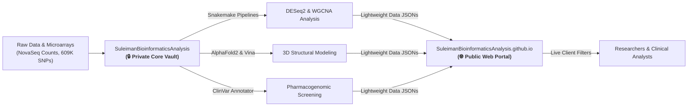

<p align="center">
  
</p>

# 🧬 SuleimanBioinformaticsAnalysis

<p align="center">
  <strong>Pioneering Multi-Omics Pipelines, AI Structural Biology & Clinical Oncology Intelligence</strong>
</p>

<p align="center">
  <a href="https://suleimanbioinformaticsanalysis.github.io"></a>
  <a href="mailto:suleyman.hacizade1@gmail.com?subject=Private%20Data%20%26%20Repository%20Access%20Request%20-%20SuleimanBioinformaticsAnalysis"></a>
  <a href="mailto:suleyman.hacizade1@gmail.com?subject=Private%20Data%20%26%20Repository%20Access%20Request%20-%20SuleimanBioinformaticsAnalysis"></a>
  <a href="https://opensource.org/licenses/MIT"></a>
</p>

---

> [!IMPORTANT]
> ### 🔒 Private Research Data & Repository Access / Məxfi Tədqiqat Məlumatları və Giriş Müraciəti
>
> **🇬🇧 English:** All primary raw sequencing datasets (FASTQ/BAM), full transcriptomic count matrices, 609K personal SNP microarray genotypes, automated Snakemake computational pipelines, and the core backend repository (`SuleimanBioinformaticsAnalysis`) in this organization are **Private** to protect genomic privacy and research integrity. Researchers, peer reviewers, and academic collaborators who wish to obtain access may apply via email:
> - 📧 **Request Access via Email:** [**suleyman.hacizade1@gmail.com**](mailto:suleyman.hacizade1@gmail.com?subject=Private%20Data%20%26%20Repository%20Access%20Request%20-%20SuleimanBioinformaticsAnalysis)
>
> **🇦🇿 Azərbaycan dili:** Bu təşkilatdakı bütün əsas tədqiqat dataları (xam sekvensiya oxunuşları, 609K şəxsi SNP genotip massivləri, hesablama boru xətləri) və əsas baza repozitoriyası (`SuleimanBioinformaticsAnalysis`) **məxfidir (Private)**. Əgər elmi tədqiqat, akademik əməkdaşlıq və ya rəy (review) məqsədilə giriş (access) əldə etmək istəyirsinizsə, elektron poçt vasitəsilə müraciət edə bilərsiniz:
> - 📧 **E-poçt ilə Müraciət:** [**suleyman.hacizade1@gmail.com**](mailto:suleyman.hacizade1@gmail.com?subject=Private%20Data%20%26%20Repository%20Access%20Request%20-%20SuleimanBioinformaticsAnalysis)

---

## 🏛️ Organization Mission & Overview

**SuleimanBioinformaticsAnalysis** is a specialized computational genomics and biophysical oncology research organization founded by **Suleiman Hajizadeh**. Our research framework bridges high-throughput bulk and single-cell RNA-Seq transcriptomics, systems co-expression network analysis, neural network 3D protein folding (AlphaFold2), biophysical virtual screening (AutoDock Vina), and high-density clinical variant curation (NIH ClinVar).

The primary research initiative focuses on the molecular dissection and therapeutic targeting of **Triple-Negative Breast Cancer (TNBC)**.

---

## 🗂️ Dual-Repository Ecosystem Architecture

To decouple high-performance compute and private genomic databases from interactive client presentation, our organization operates two interconnected repositories:



| Repository | Scope | Visibility & Access | Purpose |
| :--- | :--- | :---: | :--- |
| 🌐 **[SuleimanBioinformaticsAnalysis.github.io](https://github.com/SuleimanBioinformaticsAnalysis/SuleimanBioinformaticsAnalysis.github.io)** | Frontend Web Portal | **Public** ([Open Portal](https://suleimanbioinformaticsanalysis.github.io)) | High-performance interactive client application rendering dynamic DEG search, Volcano Plot, single-cell UMAP clusters, 3D structural metrics, ClinVar catalog, and publication figures. |
| 🔒 **[SuleimanBioinformaticsAnalysis](https://github.com/SuleimanBioinformaticsAnalysis/SuleimanBioinformaticsAnalysis)** | Core Backend & Data Vault | **Private** ([📧 Request Access](mailto:suleyman.hacizade1@gmail.com?subject=Private%20Data%20%26%20Repository%20Access%20Request%20-%20SuleimanBioinformaticsAnalysis)) | Full computational engine hosting automated Snakemake pipelines (SRA to DEGs), 609K MyHeritage personal SNP arrays, R/Python scripts, conda environments, 53-page LLM Wiki, and raw datasets. |

---

## 🔬 Core Analytical Pillars

### 1. Bulk RNA-Seq & Differential Expression (GSE183947)
- **Model:** Negative Binomial Generalized Linear Model via **DESeq2**
- **Cohort Discovery:** 1,847 significant DEGs (|log₂FC| > 1.5, FDR < 0.05)
- **Regulation:** 923 up-regulated genes (*AKT1*, *EGFR*, *MKI67*), 924 down-regulated genes (*ESR1*, *PGR*, *ERBB2*)

### 2. Systems Co-expression Networks (WGCNA)
- **Topological Criterion:** Scale-free topology model fit $R^2 = 0.87$ ($\beta = 12$)
- **Oncogenic Module:** Turquoise co-expression module ($n = 312$ genes, $r = 0.68, P < 0.001$)
- **Master Kinase Hub:** **AKT1** isolated with maximal within-module connectivity ($k_{\text{in}} = 47.3$)

### 3. Machine Learning Oncology Classification
- **Architecture:** Random Forest classifier with **Nested 5-Fold Stratified Cross-Validation**
- **Performance:** Mean AUC-ROC = $0.91 \pm 0.03$, permutation test $P < 0.001$ (1,000 iterations)
- **Leakage Prevention:** Gene selection strictly restricted to inner cross-validation training folds

### 4. Single-Cell Transcriptomics (Seurat PBMC / TNBC)
- **Technology:** 10x Genomics Chromium platform (2,700 cells)
- **Resolution:** 9 graph-based clusters resolved in 2D UMAP space
- **Cell Annotation:** CD4+ T cells, CD8+ T cells, B cells, NK cells, CD14+ Monocytes, and Dendritic cells

### 5. AI Protein Folding & Biophysical Molecular Docking
- **AI Modeling:** Human AKT1 (UniProt P31749) modeled via **AlphaFold2** (global mean $\text{pLDDT} = 92.4$, catalytic core $\text{pLDDT} = 96.1$, $94.2\%$ Ramachandran favored) and compared against experimental crystal structure **PDB 3O96** (2.70 Å)
- **Virtual Screening:** **AutoDock Vina 1.2.5** docking demonstrating superior affinity for allosteric inhibitor **MK-2206** ($\Delta G = -9.4 \text{ kcal/mol}$, interacting with Trp80 and Asp292) over ATP-competitive inhibitor Ipatasertib ($\Delta G = -8.2 \text{ kcal/mol}$)

### 6. Personal Pharmacogenomics & ClinVar Curation
- **Cohort:** 609,387 raw SNP microarray data cross-referenced with the NIH ClinVar database
- **Key Findings:** Drug metabolism alleles in *CYP2C9* (`rs7900194`, `rs28371685`), slow acetylation in *NAT2* (`rs1801280`), protective alleles in *CR1* and *KCNMB1*, and risk alleles in *RET* and *MUC5B*

---

## 📄 Featured Research Manuscript

> **"Multi-Scale Computational Oncology Pipeline: AKT1 Hub Discovery in TNBC, AlphaFold2 Structural Prediction, and AutoDock Vina Inhibitor Characterization"**  
> *Author:* Suleiman Hajizadeh  
> *Target:* Q1/Q2 Peer-Reviewed Journal (PLOS ONE Submission Track)  
> *Draft Location:* `manuscripts/manuscript_draft.md` *(Hosted in Private Vault — [Request Access via Email](mailto:suleyman.hacizade1@gmail.com?subject=Manuscript%20%26%20Data%20Access%20Request%20-%20SuleimanBioinformaticsAnalysis))*

---

## ⚡ Quick Start & Reproduction (Authorized Collaborators)

> *Note: Cloning `SuleimanBioinformaticsAnalysis` requires repository access. To request collaborator permissions, please email **[suleyman.hacizade1@gmail.com](mailto:suleyman.hacizade1@gmail.com?subject=Private%20Data%20%26%20Repository%20Access%20Request%20-%20SuleimanBioinformaticsAnalysis)**.*

```bash
# 1. Clone the core backend pipeline repository (requires authorized access)
git clone https://github.com/SuleimanBioinformaticsAnalysis/SuleimanBioinformaticsAnalysis.git
cd SuleimanBioinformaticsAnalysis

# 2. Recreate the verified Conda environment
conda env create -f environment.yml
conda activate bioinfo-analysis

# 3. Execute the automated Snakemake pipeline
cd workflows/bulk_rnaseq
snakemake --cores 8

# 4. View results in the public interactive web portal
open https://suleimanbioinformaticsanalysis.github.io
```

---

## 👤 Leadership, Data Access & Contact

**Suleiman Hajizadeh**  
*Bioinformatician & Computational Biologist*  
Institute of Molecular Biology and Biotechnologies (IMBB), Azerbaijan  
- 🌐 **Interactive Web Portal:** [suleimanbioinformaticsanalysis.github.io](https://suleimanbioinformaticsanalysis.github.io)
- 📧 **Data Access & Inquiries (Email):** [suleyman.hacizade1@gmail.com](mailto:suleyman.hacizade1@gmail.com?subject=Private%20Data%20%26%20Repository%20Access%20Request%20-%20SuleimanBioinformaticsAnalysis)
- 💻 **Personal GitHub Profile:** [@SuleimanHajizadeh](https://github.com/SuleimanHajizadeh)
- 📍 **Location:** Baku, Azerbaijan
